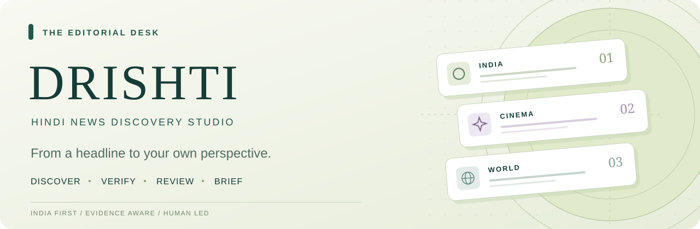
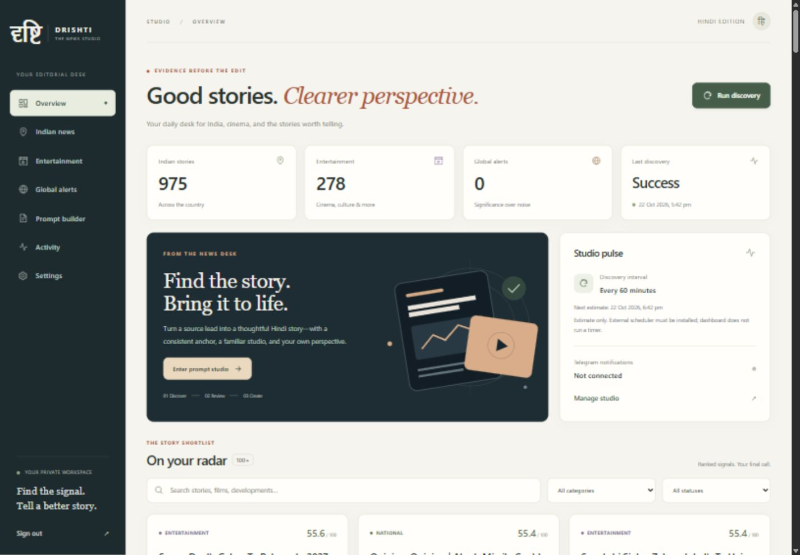
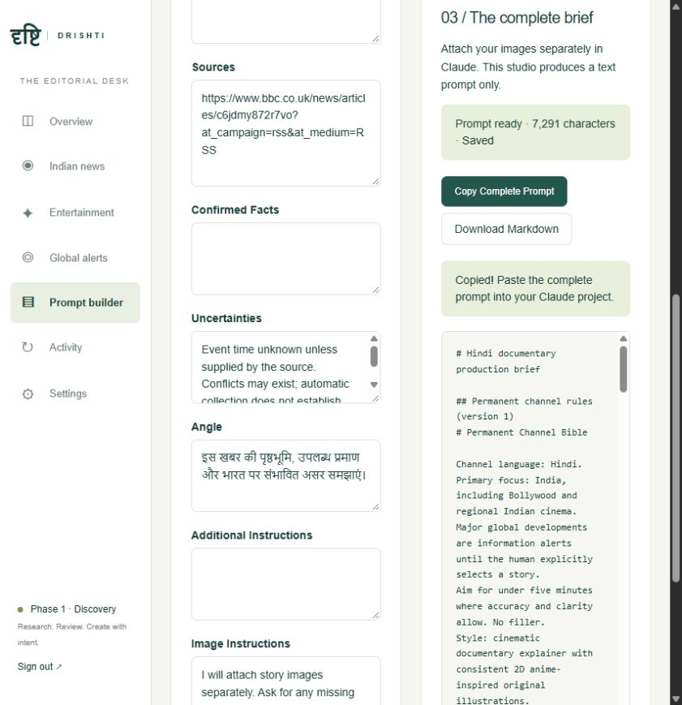
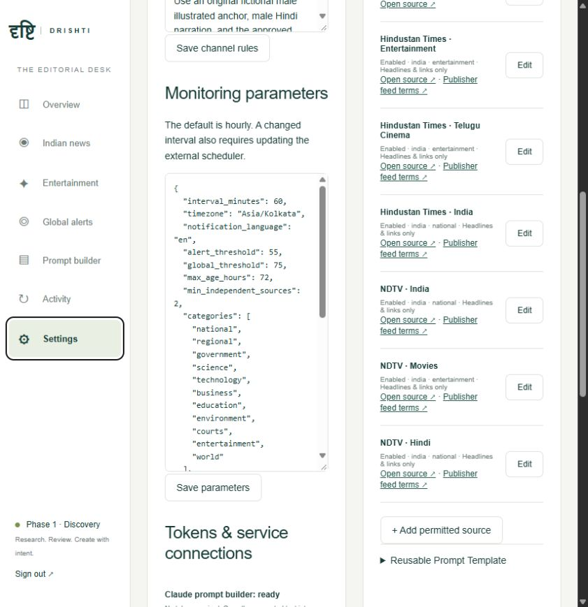
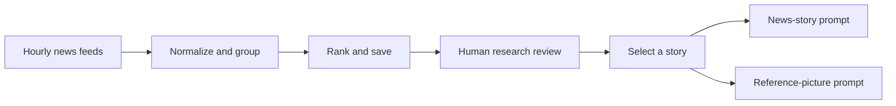

<p align="center">
  
</p>

<p align="center">
  <strong>A clearer view. A stronger story.</strong><br />
  Discover Indian news and cinema, review the evidence, and shape your next original Hindi documentary.
</p>

<p align="center">
  <a href="#quick-start">Quick start</a> &nbsp;·&nbsp;
  <a href="#inside-the-studio">The studio</a> &nbsp;·&nbsp;
  <a href="#news-sources">News sources</a> &nbsp;·&nbsp;
  <a href="#documentation">Documentation</a>
</p>

<p align="center">
  <kbd>Python 3.14</kbd> &nbsp;
  <kbd>FastAPI</kbd> &nbsp;
  <kbd>Next.js 16</kbd> &nbsp;
  <kbd>TypeScript</kbd> &nbsp;
  <kbd>React 19</kbd>
</p>

---

## Your editorial desk, in one place

**Drishti** is a private news-discovery and research workspace for a Hindi documentary channel. It follows configured news feeds, brings related coverage together, makes its ranking signals visible, and prepares a complete production brief for your separate Claude workflow.

You choose the story. You review the evidence. You approve production and publishing.

<p align="center">
  
</p>

| Discover | Review | Prepare |
| :--- | :--- | :--- |
| **An hourly news watch**<br />Indian developments, Bollywood, regional cinema, and significant global events. | **Evidence beside the headline**<br />Source links, timestamps, uncertainty, transparent scores, and saved editorial decisions. | **A complete Claude brief**<br />Editable research, permanent channel identity, visual direction, and human approval gates. |

## Inside the studio

- **Indian news:** search and filter candidates, inspect source coverage, and select what deserves your attention.
- **Entertainment:** follow releases, industry developments, regional cinema, and attributed box-office or record claims.
- **Global alerts:** review significant developments separately; a global story needs deliberate selection before a video prompt.
- **Research trail:** keep confirmed facts, attributed claims, uncertainty, and original source records distinct.
- **Prompt builder:** generate a **news-story prompt** and a **reference-picture prompt**. Copy/download either separately or both together for your Claude video agent. **No API token is needed for prompt generation.**
- **Channel Bible:** save your Hindi language, fictional illustrated anchor, visual identity, narration preferences, and approval workflow once.
- **Consistent 2D presentation:** permanent anchor/newsroom references, story pacing, layered illustrations, limited character animation, maps, timelines and charts are included in both prompts. The downstream agent checks available references and tools before production; the studio supplies text only.
- **Episode direction:** choose target length, story structure, 2D animation style and anchor screen time. Both prompts receive the same current evidence snapshot, source IDs, dates and research-gap notes.
- **Saved prompt versions:** reopen the latest 20 snapshots per story, with separate/combined copy and downloads. Older story-only records stay accessible; regenerate to add a picture prompt and apply current rules.
- **Draft recovery:** unsaved story edits survive refreshes and story switching in the same browser tab. Save edits or generate a pair for durable studio storage. Expired sessions return to sign-in with draft recovery.
- **Telegram:** receive eligible alerts through your own configured bot, with delivery tracking, retry handling, and duplicate suppression.
- **Activity and settings:** review monitoring results, source errors, connection status, and persistent configuration.
- **Cost-conscious deployment:** conditional feed requests, batched database work, indexed queries, small Consumption containers and short hourly jobs. See [Azure cost design](docs/AZURE-COSTS.md); database and other resource charges remain separate.

<details>
<summary><strong>See the prompt builder</strong></summary>

<br />



The news-story prompt includes research evidence, your edits, source links, the Channel Bible, and production instructions. The separate reference-picture prompt describes the story-specific illustration. Attach reference images separately in Claude; copying text does not transfer image files. Use the two tabs and separate/combined copy and download controls for the handoff.

</details>

<details>
<summary><strong>See the connected news feeds</strong></summary>

<br />



</details>

## From headline to production brief



The next stage happens in your **separate production workflow**: research approval → Hindi script approval → storyboard approval → final video review → separate publishing authorization.

Drishti's Phase 1 scope ends at the production brief. Video rendering, voice generation, image generation, and YouTube uploading are outside this application.

## Quick start

**Windows prerequisites:** Git, Python **3.14**, and Node.js **24 LTS**.

```powershell
git clone https://github.com/Sandeep37-s/news-agent.git
Set-Location news-agent

python -m venv .venv
.\.venv\Scripts\python.exe -m pip install -r requirements.lock
.\.venv\Scripts\python.exe scripts/setup.py
.\.venv\Scripts\python.exe -m alembic upgrade head
.\.venv\Scripts\python.exe -m backend.bootstrap

npm.cmd --prefix frontend ci
npm.cmd --prefix frontend run build
.\Start-Studio.ps1
```

Open **[localhost:3000](http://localhost:3000)** and sign in using the generated `ADMIN_PASSWORD` in your private `.env` file.

1. Run **Discovery** and open an interesting story.
2. Review its evidence and edit the research.
3. Open **Prompt builder** and click **Select for video & generate prompt**.
4. Copy the complete prompt into Claude and attach your reference images.

For a guided installation, updates, and transferring between computers, see **[Laptop setup](LAPTOP-SETUP.md)**. Each new installation creates its own local password and database. Secrets and the original computer's database are excluded from Git.

## News sources

| Publisher | Connected feeds | Collection mode |
| :--- | :--- | :--- |
| **BBC News** | India · World | Feed headlines and available short excerpts |
| **NDTV** | India · Hindi · Movies | Headlines, publisher, timestamps, and links |
| **Hindustan Times** | India · Entertainment · Telugu Cinema | Headlines, publisher, timestamps, and links |

The default schedule is **every 60 minutes**. A source failure is recorded without hiding successful results from other sources. New connections can use RSS/Atom or a configured, permitted JSON news/search API.

**Discovery is the first step.** Headline-only records are research leads, not independently verified accounts. Scores use configurable heuristics; a high score does not establish truth. Unknown reporting origins do not count as independent confirmation, and syndicated reports must share provenance.

Publisher terms remain applicable. NDTV and HT's free-feed terms include personal/non-commercial restrictions; enabling a feed does not obtain commercial content rights. Articles, clips, images, and music are not licensed by these connections. Check the [NDTV feed terms](https://www.ndtv.com/rss) and [HT feed terms](https://www.hindustantimes.com/rss) for your intended use.

Direct Google, YouTube, X/Twitter, and Instagram discovery connectors are not implemented.

## Connections and configuration

| Feature | What it needs |
| :--- | :--- |
| Dashboard, RSS discovery, and prompt builder | Local installation; no external API token required |
| Telegram notifications | `TELEGRAM_BOT_TOKEN` + authorized `TELEGRAM_CHAT_IDS` |
| Optional AI research drafts | `AI_BASE_URL`, `AI_API_KEY`, `AI_MODEL`, and `ai_enabled` in settings |
| Azure operation | An actual deployment, cloud database, secrets, and scheduled job |

`scripts/setup.py` generates the local administrator password and session secret. Keep credentials in `.env` or Azure Key Vault. **Settings → Tokens & service connections** displays setup status without revealing secret values.

The default research mode is source-attributed extraction. Optional AI produces labeled drafts with call limits, reserved-cost budgets, and usage tracking; it does not establish independent verification. No paid image or video API is required in Phase 1.

| Saved item | Location |
| :--- | :--- |
| Initial sources and scoring parameters | `config/sources.json` · `config/settings.json` |
| Permanent channel rules | `config/channel_bible.md` |
| Reusable prompt template | `config/video_prompt_template.md` |
| Local stories, research, decisions, settings, and prompt history | `data/studio.db` |
| Private server credentials | `.env` — excluded from Git |

Defaults load once. After initialization, edit live configuration in the dashboard; changing a seed file does not overwrite saved settings. Previous configuration versions remain in the audit history.

## Run it your way

| Environment | Setup | Current verification |
| :--- | :--- | :--- |
| **Local Windows** | FastAPI + Next.js + SQLite | Running application and browser workflow verified |
| **Hourly local monitoring** | Windows Task Scheduler | Successful scheduled runs observed on the development machine |
| **Docker Compose** | Web + API + PostgreSQL + migration service + one-off worker | Configuration supplied; container execution still needs verification |
| **Azure** | Container Apps + hourly Container Apps Job + managed PostgreSQL | Deployment files supplied; **not deployed** |

Install the hourly task on your machine:

```powershell
.\scripts\Install-HourlyTask.ps1
```

Use `Stop-Studio.ps1` to stop the local web application. The monitoring task is separate and requires the computer to remain available. For operation while your computer is off, follow the **[Azure deployment guide](docs/AZURE.md)**. The supplied cloud schedule is `0 * * * *`.

## Built with

```text
Browser dashboard     Next.js · React · TypeScript
Application API       Python · FastAPI
Persistent storage    SQLAlchemy · Alembic · SQLite locally / PostgreSQL for deployment
News ingestion        Pluggable RSS, Atom, and JSON adapters
Notifications         Official Telegram Bot API + persistent delivery records
Cloud configuration   Docker · Azure Container Apps · scheduled Container Apps Jobs
```

Database/process locks prevent overlapping monitor runs. Research and decisions remain saved when notifications fail. Retrieved content is treated as untrusted data, and AI drafts have no tool execution access.

## Verification

**65 backend tests and 6 frontend tests passed locally**, and the production Next.js build passed. Checks cover evidence snapshots, prompt history, browser drafts, session/error handling, migrations, feed redirects and malformed entries, alert eligibility at delivery, Telegram failure handling and existing editorial rules. The [GitHub checks workflow](.github/workflows/checks.yml) runs tests and builds on pushes and pull requests; check its actual run status before treating a commit as verified remotely.

```powershell
.\.venv\Scripts\python.exe -m pytest -q
npm.cmd --prefix frontend test
npm.cmd --prefix frontend run typecheck
npm.cmd --prefix frontend run build
```

Tests use fixtures and a temporary database. They cover parsing, deduplication, clustering, ranking, classification, scheduler locking and recovery, migrations, authentication, configuration, Telegram failure handling, prompt export, AI budgets, and headline-only collection.

See **[Verification notes](docs/VALIDATION.md)** for limitations and the external checks still required, including real Telegram/AI credentials, Docker, managed PostgreSQL and an actual Azure deployment.

## Documentation

| Start here | Go deeper |
| :--- | :--- |
| [Install on your laptop](LAPTOP-SETUP.md) | [Development and configuration](docs/DEVELOPMENT.md) |
| [Review coverage](docs/CODE-REVIEW.md) | [Automated checks](.github/workflows/checks.yml) |
| [Quick operating guide](QUICK-START.md) | [Telegram setup](docs/TELEGRAM.md) |
| [Original project brief](docs/PROJECT-BRIEF.md) | [Azure deployment](docs/AZURE.md) |
| [Entertainment requirements](docs/ENTERTAINMENT-REQUIREMENTS.md) | [Operations and troubleshooting](docs/OPERATIONS.md) |

---

<p align="center">
  <strong>दृष्टि · DRISHTI</strong><br />
  <sub>Source-led research. Human-led decisions.</sub>
</p>
