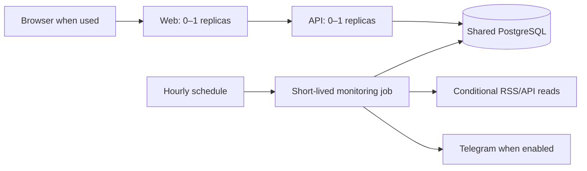

# Cost-conscious Azure design

This deployment is sized for one editor, hourly news discovery and two text prompts. It does not render images, voice or videos. These changes prepare a smaller deployment; they do not create Azure resources or guarantee a bill or a credit lifetime.

## Compute defaults

| Component | New default | Controls |
|---|---|---|
| Web | Consumption, 0.25 vCPU / 0.5 GiB, 0–1 replicas | `webSize`: `small` or `standard` |
| API | Consumption, 0.25 vCPU / 0.5 GiB, 0–1 replicas | `apiSize`: `small` or `standard` |
| Hourly monitor | Consumption, 0.25 vCPU / 0.5 GiB, one job replica | `workerSize`; 600-second default timeout, zero automatic job retries |
| Migration | Manual job, same worker size, database credentials only | Run once per release that needs migrations/bootstrap |

`standard` restores the previous 0.5 vCPU / 1 GiB allocation for an individual component. The smaller defaults halve the allocated resources, not necessarily the bill: runtime, cold starts, requests and other resources affect cost. Measure memory, throttling and successful job duration after deploying; move a component to `standard` if required. Actual Azure runtime under these limits has not yet been validated.

The existing Container Apps environment must support its built-in **Consumption** workload profile. The template explicitly selects it. Existing environment resources or features can have their own charges. Azure bills app resources and requests; completed jobs stop consuming compute resources. See [Container Apps billing](https://learn.microsoft.com/en-us/azure/container-apps/billing) and [supported workload sizes](https://learn.microsoft.com/en-us/azure/container-apps/workload-profiles-overview).

The dashboard has no continual refresh/keep-warm loop. HTTP scaling retains Azure's platform behavior; no claim is made that a custom cooldown overrides HTTP scaling. Avoid adding external uptime probes that continuously wake otherwise idle web/API apps. See [scaling behavior](https://learn.microsoft.com/en-us/azure/container-apps/scale-app).

## Less repeated work

- Persist ETag/Last-Modified feed validators. A valid `304 Not Modified` skips downloading and parsing unchanged content while freshness checks, recovery and queued delivery still run. Savings depend on publisher support; feeds without validators use normal retrieval.
- Tie validators to the source URL/kind/options. Editing a source clears its state. Empty or invalid feeds do not gain a successful cache state. Redirect and private-address checks still apply.
- Look up known article URLs and exact fingerprints in batches. Commit ingestion once per source, with research recovery preserved after interruption.
- Rank and research in batches of 200 stories, fetching article metadata once per ranking batch and full evidence once per research batch. Avoid loading excerpts and saved research just to calculate a score. Old stories are still aged so expired alerts are not kept eligible.
- Add indexes for recent runs, due notifications, daily AI reservations and saved prompt history.
- Bound feed attempts (default two), request timeout (12 seconds) and source time budget (30 seconds). The source budget is checked between requests/chunks; DNS or an in-flight read can overrun it. The Azure job timeout remains the external execution limit. A slow job can fail visibly and recover on the next run.
- Queue notifications in the existing transaction rather than committing every candidate; persist the sending state before actual delivery. Duplicate suppression and uncertain-delivery handling remain intact.

Regression fixtures verify **two article-read SELECTs for 300 stored stories** and **three commits before research for 120 articles across two feeds** (run record plus two source commits). The entire 120-article fixture run uses at most six commits with AI disabled. Parent stories are flushed before their articles, and SQLite tests enforce foreign keys. These measure fixture work, not Azure money or full production throughput.

## Optional services and logging

`enableTelegram` defaults to `false`; no Telegram Key Vault secrets are referenced until enabled. The API still requires database/admin/session secrets. The monitor loads database and optional Telegram credentials; the migration job loads only the database credential. The shared managed identity's actual role permissions still need deployment review.

Prompt creation uses local templates. Optional paid AI research remains disabled by default and has daily application limits if explicitly enabled. No AI/video/image service is required for this studio's two outputs.

API access logging remains off; the worker emits one compact result per run, while source errors and editorial history remain in the database. Configure ingestion limits and appropriate retention on the **existing** Azure logging environment. Do not remove failure visibility to reduce logs. The template does not modify shared environment logging. See [Azure log destinations](https://learn.microsoft.com/en-us/azure/container-apps/log-options).

## Costs code does not remove

Managed PostgreSQL, stored data/backups, registry storage, Key Vault, networking, logs and optional external APIs have separate cost drivers. Hourly monitoring needs the database available, so automatically stopping it at night would break the requested workflow. Web/API scale-to-zero does not stop the database. Review a suitable database tier and actual region/subscription pricing before deployment; the template reuses an existing database rather than choosing a paid tier for you. See [PostgreSQL service and cost controls](https://learn.microsoft.com/en-us/azure/postgresql/overview).

Set Azure Cost Management budget alerts before deployment and inspect actual charges after initial use. Budget alerts notify; they are not a hard spending cap. See [Microsoft's budget documentation](https://learn.microsoft.com/en-us/azure/cost-management-billing/costs/tutorial-acm-create-budgets). This code contains no automatic billing-account shutdown, resource deletion or production data-retention deletion.
